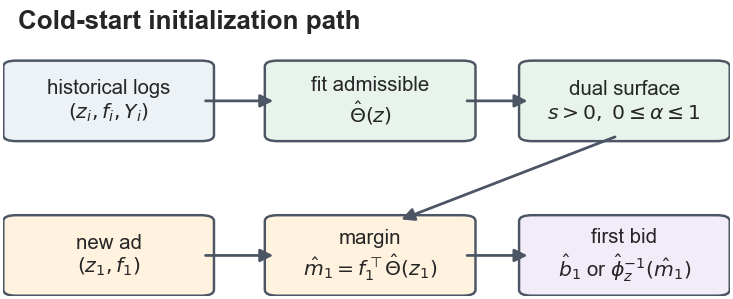

# Cold-Start Constrained Autobidding

Code for [**Cold-Start Constrained Autobidding via Implied-Dual Calibration**](https://doi.org/10.1145/3799682.3841153), CIKM 2026.



A new ad must choose its first bid before receiving ad-specific feedback.
Implied-dual calibration reuses compact constraint and market information from
related historical contexts and converts it into bids under a supported auction
format.

## Run an experiment

From the repository root, run the paper's controlled warm-start experiment:

```bash
python3 -m experiments.warm_start
```

This runs **100 seeds and 100 controller updates** using only Python's standard
library. Results and a readable report are written to `experiments/results/`.

The three main cases are:

| Experiment | Command | Evidence |
| --- | --- | --- |
| Public BAT calibration | `python3 -m experiments.bat_calibration` | Admissible calibration of the BAT proxy target; full public CSVs. |
| Supported bridge | `python3 -m experiments.supported_bridge` | Semi-synthetic known bid maps; 100 seeds, 60 contexts, sensitivity grid. |
| Controlled warm start | `python3 -m experiments.warm_start` | Initialization and auction-response comparisons over 100 seeds. |

BAT requires local CSVs or a dataset download. The bridge and warm-start cases
need no external data. All three commands default to the paper settings.

## Repository guide

- [`experiments/`](experiments/README.md): the three experiment entry points and selected results.
- [`src/`](src/): implementation, plotting, and supporting diagnostics.
- [`tests/`](tests/): replay and bridge regression checks.
- [Reproduction guide](docs/reproducing.md): inputs, outputs, figures, and supplementary analyses.
- [Evaluation protocol](docs/evaluation.md): splits, baselines, endpoints, and uncertainty.

Raw datasets and local caches are excluded from Git. Public BAT calibration is
reported as proxy evidence; decision effects are evaluated separately under the
bridge's known bid maps and the controlled warm-start settings.
