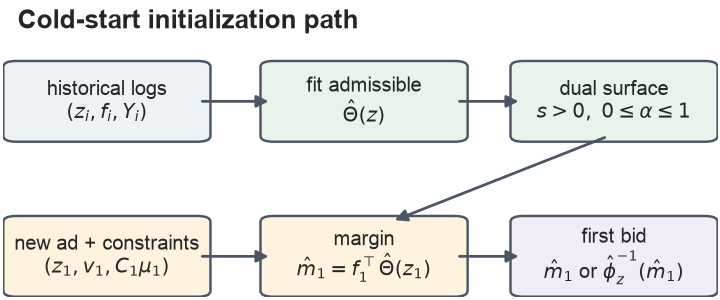
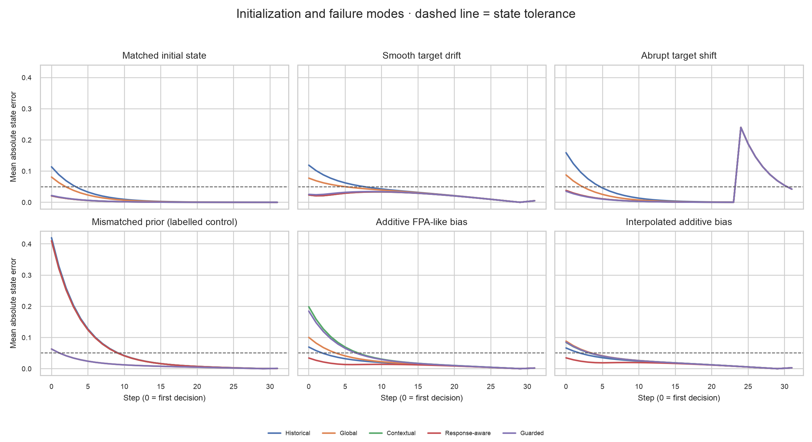

# Cold-Start Constrained Autobidding

Код к отправленной статье **Cold-Start Constrained Autobidding via Implied-Dual Calibration**. Этот README описывает реализацию и воспроизведение экспериментов; текст статьи не редактируется.

В статье рассматривается **первый период торгов нового объявления на существующем рынке**. У объявления ещё нет собственных кликов, конверсий и расходов, но уже есть прогнозы CTR/CVR, бюджет, целевой CPC и история похожих рыночных контекстов. Задача — выбрать начальную ставку; последующие обновления относятся уже к адаптации.



**Что получилось:** теория связывает ошибку калибровки с ошибкой первого решения при явных условиях поддержки. BAT подтверждает возможность калибровки агрегатного proxy, но **не подтверждает улучшение результата одновременно с соблюдением бюджетного критерия**. Синтетические проверки показывают эффект заданной инициализации и её ошибки; они не заменяют проверку полного аукционного алгоритма.

## Какая модель рассматривается

Для окна торгов максимизируем ожидаемые конверсии при бюджете `B` и ожидаемом CPC не выше `C`:

```text
maximize  Σ v_j W_j(b_j)
subject to Σ P_j(b_j) ≤ B
           Σ [P_j(b_j) − C μ_j W_j(b_j)] ≤ 0
```

`W_j(b)` — вероятность выигрыша, `P_j(b)` — ожидаемый платёж с учётом нулевого платежа при проигрыше. Ценность каждой конверсии здесь равна единице. Ограничение CPC записано без деления на число кликов.

Бюджетный множитель `p` и CPC-множитель `q` дают компактные координаты:

```text
s = 1 / (p + q),   alpha = q / (p + q)
m = s(z) v + alpha(z) C μ
```

История используется для оценки **поверхности `Theta(z) = (s(z), alpha(z))`**. На новом объявлении вычисляем margin `m`, затем ставку. Для SPA/VCG при соответствующих предпосылках `b = m`; для FPA требуется обращение `phi_z(b) = b + G_z(b)/g_z(b)`. Без поддержанной модели платежей/распределения это обращение нельзя считать известным.

| Параметр модели | За что отвечает |
| --- | --- |
| `μ = CTR` | Вероятность клика на показ. |
| `v = CTR × CVR` | Вероятность конверсии при единичной ценности; не денежная стоимость. |
| `C`, `B` | Целевой CPC и бюджет рассматриваемого окна. В BAT `contact_price_bin` используется как объявленный proxy-признак, а не непосредственно наблюдённый CPC. |
| `p ≥ 0`, `q ≥ 0` | Множители бюджетного и CPC-ограничений; предполагается `p + q > 0`. |
| `s > 0` | Обратная суммарная dual-нагрузка, масштаб компоненты конверсий. Зависит от обоих множителей. |
| `0 ≤ alpha ≤ 1` | Доля CPC-множителя в суммарной нагрузке, не вероятность. `alpha=0` означает `q=0`; `alpha=1` означает `p=0`. |
| `z`, `f = (v, Cμ)` | Рыночный контекст и признаки, из которых вычисляется margin. Калибровочные контексты BAT — укрупнённые категории; category × hour — отдельная диагностическая визуализация. |
| `Y†` | Цель калибровки: структурный margin при соответствующей наблюдаемости либо явно указанный proxy. |
| `lambda_Theta` | Вес регуляризации в общей постановке статьи. Текущая BAT-реализация решает constrained least squares **без этого штрафа** (`lambda_Theta=0`). |
| `phi`, `G`, `g` | Карта margin–bid, CDF и плотность критической цены. Их наличие — отдельное условие для FPA. |
| `epsilon`, `eta`, `c_phi` | Ошибка dual-поверхности, ошибка карты ставок и нижняя граница её производной в теореме. Гарантия локальная, на поддержанном интервале. |

Допустимость `s ≥ 1e-8`, `0 ≤ alpha ≤ 1` обеспечивается внутри BAT-оптимизации. Свободная линейная регрессия остаётся только proxy-диагностикой. Даже допустимые коэффициенты не становятся структурными dual-параметрами, если целевой показатель не имеет нужного экономического смысла.

## Что показывают данные

Числа ниже относятся к сохранённому полному BAT replay и его заранее заданному сравнению `shrunk_contextual_idvc` против `historical_stationary_context_bin`. Успех требует **положительной нижней границы 95% CI прироста контактов и неположительной верхней границы CI изменения нарушения бюджета**.

| Проверка | Полученный результат | Обоснованный вывод |
| --- | --- | --- |
| BAT FPA, early-AUC контактов | **−42.09%**, CI [−44.35, −39.72]%; нарушение бюджета уменьшается | Политика слишком консервативна; основной критерий не пройден. |
| BAT VCG, early-AUC контактов | **+8.31%**, CI [+7.04, +9.69]%; нарушение бюджета растёт на **9.00**, CI [7.76, 10.35] proxy-единиц | Рост результата сопровождается большим нарушением; критерий не пройден. |
| BAT held-out proxy MSE, VCG | Flat IDVC **47.42**, contextual **43.29**, category-price mean **31.40** | Контекст улучшает компактную модель, гибкая reference-модель предсказывает лучше. |
| BAT held-out proxy MSE, FPA | Flat IDVC **6765.23**, contextual **6696.68**, category-price mean **3983.17** | Допустимость и компактность не означают лучшую точность. |
| Скалярный bridge, 100 seeds × 60 контекстов | Guarded early-AUC **+4.10%**, CI [+4.09, +4.12]%; все 9 sensitivity-ячеек проходят искусственный критерий | Польза заданной инициализации в выбранной симуляции; не lift на BAT. |

Источники: [BAT gate](experiments/results/tables/bat_frontier_gate_status.csv), [BAT replay CI](experiments/results/tables/bat_frontier_bootstrap.csv), [полная калибровка](experiments/results/bat_full_admissible.md), [bridge](experiments/results/supported_bridge.md). Это reference-результаты; ваши новые запуски сохраняются отдельно в `outputs/`.

В BAT цель — `AuctionWinBidSurplus / max(AuctionCount, 1)`; при отсутствии surplus код явно использует fallback `contact_price_bin`. Это **не сырые winning prices**. Периодический holdout калибровки (`period // 3600 mod 5`, fold 4) — диагностическое разбиение; cold-start replay использует отдельное хронологическое разбиение кампаний 70/10/20.

Оба основных синтетических runner задают начальные скалярные состояния около известной истины. Они не обучают `Theta`, не моделируют реальные расходы/CPC и не обращают `phi`. В warm start mismatch-сценарий принудительно включает abstention по известной метке: это отрицательный контроль, не измерение качества реального детектора. Отдельный `src/run_full_synthetic.py` проверяет формулы и обращение нелинейной карты; его нельзя смешивать с bridge.

## Запуск

Из корня репозитория:

```bash
python3 -m venv .venv
source .venv/bin/activate
pip install -r requirements.txt
python -m experiments
```

По умолчанию запускается `warm_start`: 100 seeds × 100 обновлений, без загрузки данных. Откройте `outputs/warm_start/index.html`: там результаты, комментарии, использованные параметры и PNG/PDF.

```bash
python -m experiments warm_start
python -m experiments supported_bridge
python -m experiments bat_calibration --max-rows 100000  # только проверка pipeline
python -m experiments bat_calibration                    # полная калибровка
```

BAT использует локальные CSV, если они есть, иначе читает публичные CSV по сети. Bridge тоже синтетический, данные не загружает. Запуск печатает стадии, прогресс долгой обработки и результаты sensitivity-ячеек.

Чтобы сохранить отдельный вариант:

```bash
python -m experiments warm_start --gain 0.4 --output-dir outputs/gain-04
```

Конфигурация: **CLI > пользовательский YAML > `config.yaml`**. Повторный запуск в той же папке обновляет результаты; новый `output_dir` сохраняет сравнение.

## Параметры экспериментов

Все поля [`config.yaml`](config.yaml) перечислены ниже. Сценарные константы зафиксированы в runner-файлах и описаны в [протоколе](docs/evaluation.md).

| Поле | Значение по умолчанию и смысл |
| --- | --- |
| `tasks` | `[warm_start]`; задачи, выполняемые по порядку. |
| `output_dir` | `outputs`; родительская папка результатов. |
| `plots`, `progress` | `true`; строить графики и показывать ход выполнения. |
| `seeds` | `100` для обеих симуляций; число независимых случайных запусков. |
| `seed` | Warm: `20260519`, bridge: `20260522`; начальный seed генератора, далее `seed + offset`. |
| `horizon` | Warm: `100`; число обновлений скалярного контроллера. |
| `contexts` | Bridge: `60`; число искусственных контекстов на seed, не число BAT-категорий. |
| `horizons` | Bridge: `[1,3,6,12,24]`; срезы оценки. Симуляция идёт до последнего среза. |
| `gain` | Warm: `0.22`, bridge: `0.24`; обновление `u_next = u − gain × (u − target)`. Для постоянной цели устойчиво при `0 < gain < 2`; при `gain > 1` возможны колебания. |
| `tolerance` | `0.05`; допуск абсолютной ошибки состояния. **Не 5% бюджета/CPC.** |
| `guard_z` | `1.65`; порог отказа от contextual transfer. Warm: `abs(contextual−flat)/0.18`, bridge: `/0.16`. Это заданные масштабы диагностики. |
| `shrinkage` | Warm: `6`, bridge: `100`; вес contextual-состояния `n/(n+shrinkage)`, где `n` — заданная синтетическая поддержка; при отказе используется global. Больше значение — сильнее притяжение к global. В bridge смешивается bias-corrected state. Это не `lambda_Theta`. |
| `bootstrap_seed` | Bridge: `20260522`; случайность доверительных интервалов, отдельно от генерации симуляции. |
| `bootstrap_resamples` | Bridge: `1000`; число кластерных bootstrap-перевыборок. |
| `sensitivity` | Bridge: `true`; запуск сетки shift × response-bias. |
| `sensitivity_grid` | `[0.85,1.0,1.15]` для каждой оси, всего 9 комбинаций; фиксированная проверка чувствительности, не подбор по test. |
| `only` | BAT: `both`; `vcg`, `fpa` либо оба формата. |
| `full` | BAT: `true`; читать все строки, если не задан `max_rows`. |
| `sample_rows` | `100000`; лимит, когда `full=false` и нет `max_rows`. |
| `max_rows` | `null`; явный положительный лимит статистики каждого формата, имеет приоритет над `full`. Ограниченный запуск — smoke check. |
| `campaign_max_rows` | `null`; отдельный лимит метаданных. Его уменьшение может ухудшить сопоставление строк с кампаниями. |
| `min_category_rows` | `500`; минимум train-строк для contextual fit, иначе используется flat fallback. |
| `timeout` | `180` секунд; сетевой timeout, не ограничение длительности эксперимента. |
| `top_categories` | `10`; число категорий-кандидатов для category × hour heatmap. Не меняет основной fit. |
| `min_cell_rows` | `5000`; минимум строк в ячейке heatmap. Недостаточно поддержанные ячейки серые, без интерполяции. |
| `vcg_stats`, `vcg_campaigns`, `fpa_stats`, `fpa_campaigns` | `null`; явные пути/URL источников. При `null` используются `experiments/data/bat/raw/{vcg,fpa}/{stats,campaigns}.csv`, если доступны, иначе публичный BAT. |

## Как читать графики и метрики



Накопленная награда после сходимости почти линейна и скрывает различия. Поэтому основной диагностический рисунок показывает **ошибку состояния на первых 32 шагах**; шаг 0 — первая ставка, далее адаптация. Пунктир — допуск. Сдвиг на шаге 24 и вредный перенос остаются видимыми. Лесной график сохраняет агрегированный эффект с CI.

- **Warm Early-AUC:** средняя накопленная искусственная награда по всем `horizon` шагам; награда шага `max(0,1−1.4|u−target|)`.
- **Bridge Early-AUC:** средняя накопленная искусственная награда на `horizons`; коэффициент штрафа за ошибку `1.35`, добавлен заданный шум.
- **BAT Early-AUC:** средние накопленные proxy-контакты на горизонтах 1/3/6/12/24; это другая величина.
- **Violation:** в симуляциях `max(0,|u−target|−tolerance)`. Warm суммирует первые 20 шагов; bridge усредняет точечные нарушения на выбранных срезах. BAT оценивает отдельный proxy-перерасход бюджета.
- **Time-to-target:** первый вход в допуск, считая с 0; длина горизонта означает отсутствие попадания. Не гарантирует дальнейшего пребывания в допуске.
- **Лесной график:** сравнение с лучшим historical/global результатом постфактум для каждого seed и сценария. Это консервативная envelope, не реализуемый селектор. Два связанных сценария сначала усредняются внутри seed, затем строится 95% CI.

## Что оставлено в коде

Основной путь: `experiments/__main__.py` → три runner → общие `config`, `progress`, `run_output`, `interpretation`, `plots`. BAT-вычисления — `experiment_utils` и `bat_surfaces`; схема — `model_figure`. Генератор статьи сохраняет таблицы и основные рисунки; старые dashboard/preview и почти прямые cumulative-reward графики больше не генерируются.

Дополнительные инструменты: `bat_cold_start_runner` — хронологический replay; `run_full_synthetic` — проверки формул/идентификации; schema/download/public-RTB checks — проверка внешних источников. Они не входят в стандартный запуск. Исходники отправленной статьи хранятся отдельно от кода экспериментов и при доработке кода не изменяются.

Проверки:

```bash
pip install pytest
python -m pytest -q
```

[Детали воспроизведения](docs/reproducing.md) · [Протокол и критерии](docs/evaluation.md) · [Результаты самостоятельной проверки](docs/validation-2026-11-02.md)
