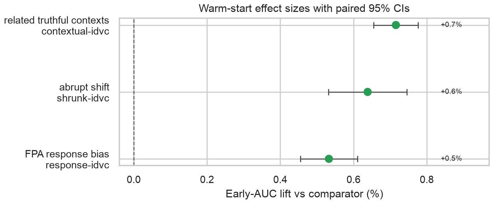
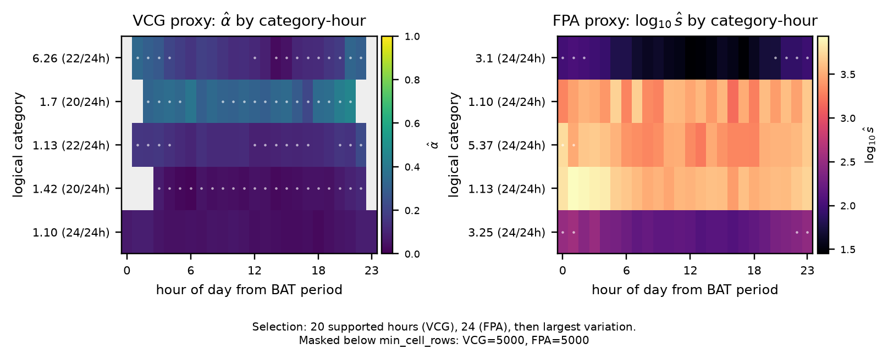
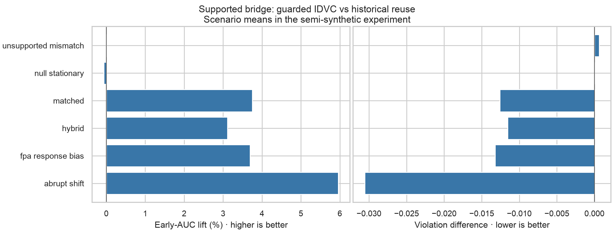

# Cold-Start Constrained Autobidding

Experiments for [**Cold-Start Constrained Autobidding via Implied-Dual Calibration**](https://doi.org/10.1145/3799682.3841153), CIKM 2026.

Historical market data → calibrated dual variables → the first bid for a new ad.


**Edit `config.yaml` → run → open your plots.**

```bash
python3 -m venv .venv
source .venv/bin/activate
pip install -r requirements.txt
python -m experiments
```

Open **`outputs/warm_start/index.html`** for your figures, PNG/PDF downloads, and
parameters. The run prints short stage updates and shows progress bars in a terminal.

To try another setting, change `gain`, `horizon`, or `seeds` in
[`config.yaml`](config.yaml) and run the same command again. Plots are rebuilt
from the new results. Change `output_dir` to keep a comparison run.

**1. Warm start — start here.** How does initialization affect early reward?
Recreates the camera-ready effect plot with 100 seeds. No download.

```bash
python -m experiments warm_start
```



Also produces reward trajectories. Open `outputs/warm_start/index.html`.

**2. BAT calibration — camera-ready heatmaps.** See how fitted dual variables
vary by category and hour in the public auction logs.

```bash
python -m experiments bat_calibration
```



Preview: full reference data. Also produces calibration loss.
Open `outputs/bat_calibration/index.html`. Uses local CSVs when available;
otherwise streams several GB of public data. Small row-capped runs may have
too few observations to draw these surfaces.

**3. Supported bridge — additional repository plots.** The camera-ready reports
this experiment in the *Supported mechanism evidence* table and the text.
The comparison below and the sensitivity plot are extra visualizations for
exploring its results; they are not figures from the camera-ready.

```bash
python -m experiments supported_bridge
```



Preview: 100 seeds × 60 contexts in the controlled synthetic experiment.
No download; slower than warm start. Open `outputs/supported_bridge/index.html`.

To run several experiments together, set
`tasks: [warm_start, supported_bridge, bat_calibration]` in `config.yaml` and run
`python -m experiments`. Each task gets its own output folder. The previews above
are saved examples; your local figures are rebuilt from your chosen parameters.

[Configuration and reproduction details](docs/reproducing.md) ·
[Evaluation protocol](docs/evaluation.md)

The bridge and warm start are controlled synthetic evidence. Public BAT fits
a declared proxy target; it does not establish deployment lift.
